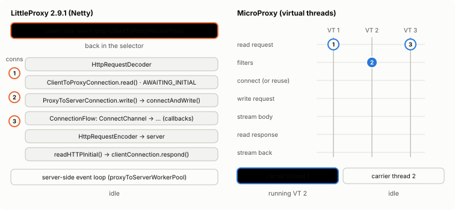
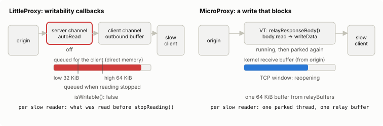
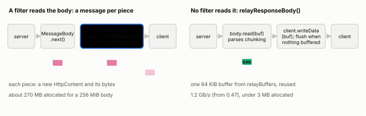
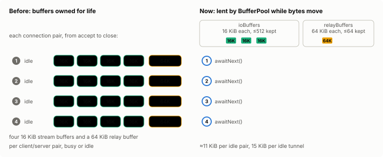
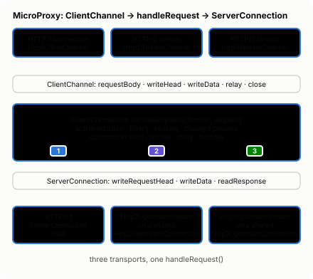

# Architecture

How MicroProxy is built: why it uses virtual threads and blocking I/O instead of Netty, what that
costs and saves, how the modules fit together, and where to read the internals. Read this before
changing the proxy's code, or to judge whether its concurrency model suits your load.

## Why virtual threads instead of Netty

LittleProxy relies on Netty's event loops, so all of its logic runs as callbacks: pipelines,
handler swapping, a `ConnectionFlow` state machine, and manual backpressure through
`channelWritabilityChanged`. MicroProxy writes the same logic as a straight-line loop:

```
read request → filters → connect (or reuse) → write request → stream body → read response → stream back
```

Each connection gets one cheap virtual thread, so blocking calls only park that thread. A slow
peer applies backpressure simply by blocking a write. The CONNECT tunnel is two loops copying
bytes, one per direction. Tens of thousands of concurrent connections are fine.

The diagrams below step through the difference; each has play, pause and step controls, and
names the classes and methods involved: MicroProxy's in
[`org.microproxy.impl`](https://github.com/mahmoudimus/MicroProxy/blob/main/microproxy/src/main/java/org/microproxy/impl/README.md),
LittleProxy's in `org.littleshoot.proxy.impl` of `io.github.littleproxy:littleproxy` 2.9.1.

<div class="mp-arch" data-scene="concurrency" data-perf-src="../assets/perf/results.json"></div>

<div class="mp-arch-static" markdown>



</div>

In LittleProxy, each client connection is a Netty channel registered with one of a few
event-loop threads (by default 8 for clients and 8 for servers), which run every connection's
callbacks in turn. A request is decoded by `HttpRequestDecoder` and handled in
`ClientToProxyConnection.read()` according to the connection's `ConnectionState`;
`ProxyToServerConnection.write()` starts a `ConnectionFlow` (`connectAndWrite()`) when no server
connection exists, and the flow's steps advance from `ChannelFuture` listeners; the response comes
back through `ProxyToServerConnection.readHTTPInitial()` and `readHTTPChunk()`, which call
`ClientToProxyConnection.respond()`. In MicroProxy the same work is the loop above, in
`ClientConnection.serveRequests()` and `handleRequest()`: a connect, a read or a write that has to
wait parks the virtual thread, and the JDK's few carrier threads run the others meanwhile. Envoy
is event-driven like LittleProxy (an event loop per worker thread); Go's `net/http`, and so
goproxy, runs a goroutine per connection like MicroProxy.

<div class="mp-arch" data-scene="backpressure"></div>

<div class="mp-arch-static" markdown>



</div>

When a client reads slowly, LittleProxy keeps reading the server until the client channel's
outbound buffer passes Netty's high water mark (64 KiB by default). Then `isWritable()` turns
false, `channelWritabilityChanged()` calls `becameSaturated()`, and `ClientToProxyConnection`
stops reading its server connections (`stopReading()`, `setAutoRead(false)`) until the buffer
drains below the low water mark (32 KiB) and `becameWritable()` resumes them. What was read before
the stop stays queued in direct memory. In MicroProxy, `relayResponseBody()` reads a piece of the
body into its 64 KiB relay buffer and writes it; when the client's socket is full the write blocks
and the virtual thread parks, so it reads no more, the bytes in flight wait in the kernel's socket
buffers, and TCP flow control slows the server. The cost per slow reader is measured on
[Performance against other proxies](project/performance.md#adversarial-clients-under-a-memory-cap).
<!-- perf:arch-slowread -->

Measured with 200 slow readers and each proxy capped at 512 MB, RSS rose by about 1,044 (985–1,120) KB per reader for LittleProxy and 151 (146–155) KB for MicroProxy (median of 5 runs, lowest–highest in parentheses).

<!-- /perf:arch-slowread -->


Bodies that no filter inspects skip the message objects entirely. They are copied between the
sockets through one reusable 64 KiB buffer per connection, re-framed only when one side uses
chunked coding, and flushed only when no more input is buffered. A filter that overrides a
content hook (`clientToProxyRequest` / `proxyToServerRequest` for requests,
`serverToProxyResponse` / `proxyToClientResponse` for responses), checked through chains as
well, gets every piece as before. On loopback with a 256 MiB body this relays about 1.2 GB/s
with `Content-Length` and 0.6 GB/s chunked, against 0.47 and 0.25 GB/s through per-chunk
objects, and allocates under 3 MB instead of about 270 MB.

<div class="mp-arch" data-scene="fastpath"></div>

<div class="mp-arch-static" markdown>



</div>

Idle connections hold almost no memory. Socket buffers are lent from a bounded per-server
pool only while bytes are moving. Between requests, a connection waits for the next byte without
a buffer, and tunnels give theirs back whenever the peer goes quiet. With 2,000 idle keep-alive
connections, each client and server connection pair costs about 11 KiB of heap, down from 141
KiB. An idle `CONNECT` tunnel costs about 15 KiB, down from 113 KiB.

Before this design, each client and server connection pair kept four 16 KiB stream buffers and a
64 KiB relay buffer for its whole life. Now `ByteReader` takes a buffer from the server's
`ioBuffers` pool when bytes arrive and gives it back once they are consumed (`release()`),
`ByteReader.awaitNext()` waits for the next request with a one-byte read and no buffer,
`PooledOutputStream` gives its buffer back on every flush, and a body borrows a 64 KiB buffer from
`relayBuffers` only while it is relayed. Each pool keeps a bounded number of free buffers (512 and
64) and leaves the rest to the garbage collector.

<div class="mp-arch" data-scene="buffers"></div>

<div class="mp-arch-static" markdown>



</div>

Per request, header handling avoids throwaway objects:

- Heads are written straight into the pooled buffer.
- Header lines are parsed into one string each, and then a single name and value.
- List-valued fields are checked in place, and URIs are checked without regular expressions.
- The `Date` value is formatted once per second.
- The request copy that the filters API hands to filters is made only when filters are configured.

A small keep-alive GET through the proxy now allocates about 4.7 KB, down from 12.1 KB, at
10-20% higher throughput. Both figures include the benchmark client's own allocations.
[Benchmarks against LittleProxy](project/benchmarks.md) measures throughput, latency,
allocation and idle footprint against LittleProxy itself, through the same origin and client.
[Performance against other proxies](project/performance.md) measures the proxy as a separate
process against LittleProxy, Envoy, a Go and a Rust proxy and Squid: sustainable rate, latency
under load, and memory when idle, with many connections and under adversarial clients.

A few rules keep this safe on JDK 21, where a virtual thread that blocks inside `synchronized`
pins its carrier thread:

- Blocking code paths use `ReentrantLock` instead of `synchronized`.
- The tests run with `-Djdk.tracePinnedThreads=short` to catch pinning.
- On JDK 24+ (JEP 491), `synchronized` no longer pins, so user filters written with
  `synchronized` are fine there too.

## What a request costs on one core

Virtual threads make each connection a straight-line loop, but every wait for a socket still
goes through the JDK's scheduler, and on a busy core that is where the proxy's time goes besides
the system calls themselves. Netty's event loops, which LittleProxy runs on, do not pay it: one
thread calls `epoll_wait`, gets every ready socket, reads each one only once it is ready, and
runs its callbacks right there.

When a virtual thread's socket read finds nothing to read (`EAGAIN`), the thread parks and
registers the socket with a poller (`epoll_ctl`, one-shot). When bytes arrive, the poller wakes,
unparks the thread, and a carrier thread runs it again, which reads again. A keep-alive request
makes two such waits: the client connection's for the request, and the server connection's for
the response. On JDK 21 each wait also passes through two platform threads: an "updater" thread
that makes the `epoll_ctl` call for the waiting thread (unless `jdk.useDirectRegister` is set)
and the poller thread, which preempts the carrier on one core every time a socket becomes ready.
A read with a timeout (`SO_TIMEOUT`, the idle timeout) also arms a timer for each park and
cancels it; on JDK 25 that wakes the scheduler's delay thread both times.

Measured at a fixed 9,537 requests a second offered, one CPU per proxy, with the
[comparison's](project/performance.md#methodology) harness, on 2026-10-13 on a shared 4-vCPU cloud
VM, a slower machine than the comparison's dedicated one. Unlike the comparison's rate sweep,
which climbs to each rate through shorter steps and judges an 8-second step, each run here goes
straight to 9,537 after the 15-second warm-up and holds it for 40 seconds, long enough for the
profiles and traces. A proxy running close to its limit builds a backlog over 40 seconds that an
8-second step does not see, so the p99 below is not the sweep's: LittleProxy kept 9,537 requests
a second within the sweep's 50 ms objective (p99 about 18 ms) but not over this longer hold. CPU,
rate and latency are medians of three interleaved runs; the system calls and thread switches were
counted over two seconds of one run on the proxy's core (`sys_enter` and `sched_switch` trace
events), per request served:

| | LittleProxy, JDK 21 | MicroProxy before, JDK 21 | MicroProxy after, JDK 21 | MicroProxy before, JDK 25 | MicroProxy after, JDK 25 |
|---|---|---|---|---|---|
| Proxy CPU per request (µs) | 103.6 | 117.6 | 97.3 | 97.5 | 83.0 |
| of which in the kernel, loopback TCP included (µs) | 49 | 87 | 82 | 69 | 61 |
| Requests served per second | 9,537 | 8,293 | 9,537 | 9,537 | 9,537 |
| p99 latency (ms) | 267 | 5,304 | 150 | 115 | 14 |
| System calls | 9.6 | 17.4 | 12.3 | 25.9 | 15.7 |
| of which `epoll_ctl` / `futex` | 0 / 0.03 | 1.8 / 2.7 | 1.9 / 0.01 | 2.1 / 10.3 | 2.4 / 1.3 |
| of which writes | 4.4 | 2.8 | 1.9 | 3.0 | 2.0 |
| of which reads that found nothing | 0.1 | 1.8 | 1.9 | 2.0 | 2.0 |
| Thread switches | 0.9 | 3.3 | 1.6 | 6.9 | 0.9 |

"Before" is release 0.3.0; "after" adds the three changes below. LittleProxy was at its limit
here too: its p99 is from a backlog that built up, not from slow requests.

MicroProxy's own code is the cheaper of the two (its user time is about half of LittleProxy's),
so what LittleProxy saved was the scheduling. Its cost per request also keeps falling as the load
rises: the busier its event loops, the more sockets each `epoll_wait` returns and the less often
a loop thread sleeps. JDK 21's poller has no such economy of scale, since every wait still makes
the same calls and the same thread switches, which is why, in the comparison's JDK 21 runs,
MicroProxy costs less per request than LittleProxy at every rate both sustain (28 µs against
34 µs at 29,104 requests a second) and still only ties it on maximum rate.

Three changes take most of that cost out:

- **One write per small response.** The response head was flushed on its own before the body,
  so a small response went to the client in two writes and two TCP segments. When the body is
  delimited by `Content-Length` and already buffered, the head now waits for it in the output
  buffer (`ClientChannel.writeHead(response, bodyAllowed, bodyFollows)`).
- **Idle timeouts without a timer per wait.** The two waits read without `SO_TIMEOUT`;
  `IdleWaits` keeps their deadlines on one thread that sleeps until the earliest is due, and
  shuts the input of a socket whose wait passed it (see the
  [design notes](https://github.com/mahmoudimus/MicroProxy/blob/main/microproxy/src/main/java/org/microproxy/impl/README.md#the-server-side-serverconnection)).
  On the comparison's dedicated machine, taking this change back out lowered MicroProxy's
  maximum rate on JDK 25 from about 49,100 to 29,900 requests a second (three runs each); on
  JDK 21, whose waits do not wake the delay thread, it made no difference.
- **Direct registration on JDK 21.** The launcher sets `jdk.useDirectRegister=true` on JDK 21,
  as JDK 22 and later always behave, which removes the updater thread from every wait.

What remains on JDK 21 is the poller thread's wake-up for every ready socket. JDK 25 removes it:
its pollers are virtual threads that poll between other work on the carriers, so a loaded core
reads many ready sockets per `epoll_wait` and seldom switches threads. With the changes, JDK 25's
cost per request falls with the load as LittleProxy's does. At 11,921 requests a second offered,
MicroProxy on JDK 25 served them all at 73 µs a request (p99 32 ms), while LittleProxy served
10,992 at 90 µs and MicroProxy on JDK 21 10,977 at 89 µs, both past their limit (medians of three
runs). On the comparison's dedicated machine the gap is wider: on JDK 25 MicroProxy sustains
48,748 requests a second on one core against LittleProxy's 36,367, where on JDK 21 the two tie at
about 36,900 (see [the JDK](project/performance.md#the-jdk)). That is why JDK 25 is the JDK to run
for throughput (see [Performance options](guides/performance.md#the-jdk-25-for-throughput)).

Garbage collection is not part of the difference: in these runs MicroProxy's young collections
paused it about 0.05% of the time (at most 2 to 4 ms each), against 0.2% for LittleProxy, which
allocates about twice as much per request.

## Modules

The proxy is the `microproxy` module; everything else is optional, and the standalone modules
depend on nothing (see [Install](getting-started/install.md#modules-and-artifacts) for the
artifacts). Each standalone module documents its own design:

| Module | Design notes |
|---|---|
| `zstd-decoder` | [zstd-decoder/README.md](https://github.com/mahmoudimus/MicroProxy/blob/main/zstd-decoder/README.md): a Zstandard decoder written from RFC 8878 |
| `http2-codec` | [http2-codec/README.md](https://github.com/mahmoudimus/MicroProxy/blob/main/http2-codec/README.md): HTTP/2 frames and HPACK |
| `http3-codec` | [http3-codec/README.md](https://github.com/mahmoudimus/MicroProxy/blob/main/http3-codec/README.md): HTTP/3 frames and QPACK |
| `quic` | [quic/README.md](https://github.com/mahmoudimus/MicroProxy/blob/main/quic/README.md): the QUIC transport, its TLS 1.3 handshake, recovery, congestion control (CUBIC, NewReno, BBR), connection migration and qlog |
| `microproxy` | [org/microproxy/impl/README.md](https://github.com/mahmoudimus/MicroProxy/blob/main/microproxy/src/main/java/org/microproxy/impl/README.md): exchanges and transports, below |
| `microproxy-otel` | [OpenTelemetry](observability/opentelemetry.md): the `FlowTracer` hook and OTLP export |
| `microproxy-starlark` | [Scripting with Starlark](guides/scripting.md); the vendored interpreter's notes are in [thirdparty/starlark/README.md](https://github.com/mahmoudimus/MicroProxy/blob/main/microproxy-starlark/src/main/java/org/microproxy/thirdparty/starlark/README.md) and [thirdparty/larky/README.md](https://github.com/mahmoudimus/MicroProxy/blob/main/microproxy-starlark/src/main/java/org/microproxy/thirdparty/larky/README.md) |

## Inside the core: exchanges and transports

A client connection runs on one virtual thread in `ClientConnection`. Its code has two layers,
split so that HTTP/2 and HTTP/3 streams reuse everything but the wire format, on either side: a
transport (`ClientChannel`: HTTP/1, one HTTP/2 stream, or one HTTP/3 request stream) and the
exchange logic (`ClientConnection.handleRequest`), which runs the filters, connects (or reuses a
connection), relays the request and response, and opens tunnels. On the server side,
`ServerConnection` is an HTTP/1.1 connection, or one stream of a shared HTTP/2 or HTTP/3
connection to the server.

<div class="mp-arch" data-scene="transports"></div>

<div class="mp-arch-static" markdown>



</div>

The package's design notes, kept next to the code in
[`microproxy/src/main/java/org/microproxy/impl/README.md`](https://github.com/mahmoudimus/MicroProxy/blob/main/microproxy/src/main/java/org/microproxy/impl/README.md), describe how a request flows
through the proxy, which parts are HTTP/1-specific, and how HTTP/2 and HTTP/3 streams run the
same exchange logic concurrently:

| Section | What it covers |
|---|---|
| [The transport: `ClientChannel`](https://github.com/mahmoudimus/MicroProxy/blob/main/microproxy/src/main/java/org/microproxy/impl/README.md#the-transport-clientchannel) | the per-transport interface the exchange logic writes to |
| [The exchange logic](https://github.com/mahmoudimus/MicroProxy/blob/main/microproxy/src/main/java/org/microproxy/impl/README.md#the-exchange-logic) | one request from head to response, on any transport |
| [The server side: `ServerConnection`](https://github.com/mahmoudimus/MicroProxy/blob/main/microproxy/src/main/java/org/microproxy/impl/README.md#the-server-side-serverconnection) | connections to servers and chained proxies, pooling |
| [CONNECT: the client's first bytes decide](https://github.com/mahmoudimus/MicroProxy/blob/main/microproxy/src/main/java/org/microproxy/impl/README.md#connect-the-clients-first-bytes-decide) | ClientHello peeking, interception, tunnels |
| [HTTP/2: `Http2Connection` and `Http2StreamChannel`](https://github.com/mahmoudimus/MicroProxy/blob/main/microproxy/src/main/java/org/microproxy/impl/README.md#http2-http2connection-and-http2streamchannel) | HTTP/2 clients, proxy requests inside a session, who picks the server, the concurrency audit |
| [HTTP/2 to servers: `Http2UpstreamConnection` and `Http2Origins`](https://github.com/mahmoudimus/MicroProxy/blob/main/microproxy/src/main/java/org/microproxy/impl/README.md#http2-to-servers-http2upstreamconnection-and-http2origins) | shared HTTP/2 connections, WebSockets to origins |
| [Frame interception: `Http2Frames`](https://github.com/mahmoudimus/MicroProxy/blob/main/microproxy/src/main/java/org/microproxy/impl/README.md#frame-interception-http2frames) | how frame interceptors stay protocol-correct |
| [HTTP/3: `Http3Connection` and `Http3StreamChannel`](https://github.com/mahmoudimus/MicroProxy/blob/main/microproxy/src/main/java/org/microproxy/impl/README.md#http3-http3connection-and-http3streamchannel) | HTTP/3 clients and CONNECT-UDP (`UdpFlow`) |
| [Transparent QUIC: `TransparentQuicListener` and `QuicFlows`](https://github.com/mahmoudimus/MicroProxy/blob/main/microproxy/src/main/java/org/microproxy/impl/README.md#transparent-quic-transparentquiclistener-and-quicflows) | redirected QUIC, stream-by-stream relaying (`QuicSession`), QUIC inside CONNECT-UDP (`MasqueQuic`) |
| [HTTP/3 to servers: `Http3UpstreamConnection` and `Http3Origins`](https://github.com/mahmoudimus/MicroProxy/blob/main/microproxy/src/main/java/org/microproxy/impl/README.md#http3-to-servers-http3upstreamconnection-and-http3origins) | shared QUIC connections to servers, HTTP/3 frames |
| [What stays HTTP/1-specific, and why](https://github.com/mahmoudimus/MicroProxy/blob/main/microproxy/src/main/java/org/microproxy/impl/README.md#what-stays-http1-specific-and-why) | the parts that are not shared |
| [Stats: `ProxyStats`, `ProtocolStats` and `QuicStats`](https://github.com/mahmoudimus/MicroProxy/blob/main/microproxy/src/main/java/org/microproxy/impl/README.md#stats-proxystats-protocolstats-and-quicstats) | how metrics are kept off the hot path |
| [Tracing: `FlowTracer`](https://github.com/mahmoudimus/MicroProxy/blob/main/microproxy/src/main/java/org/microproxy/impl/README.md#tracing-flowtracer) | the tracing hook |
| [Notes for later](https://github.com/mahmoudimus/MicroProxy/blob/main/microproxy/src/main/java/org/microproxy/impl/README.md#notes-for-later) | known gaps and ideas |

## Rules for contributors

- Never use `synchronized` in blocking code: use `java.util.concurrent.locks.ReentrantLock`, so
  virtual threads do not pin their carriers on JDK 21 (see above).
- No runtime dependencies in any module: the core, the codecs and QUIC use only the JDK.
- `AllocationTest` fails if a small keep-alive request starts allocating much more than it does
  now; `StatsFastPathTest` guards the metrics' fast path.
