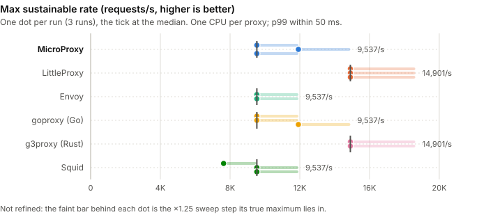
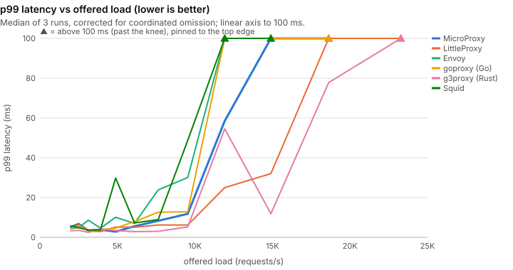
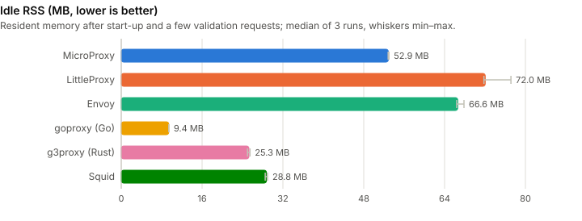
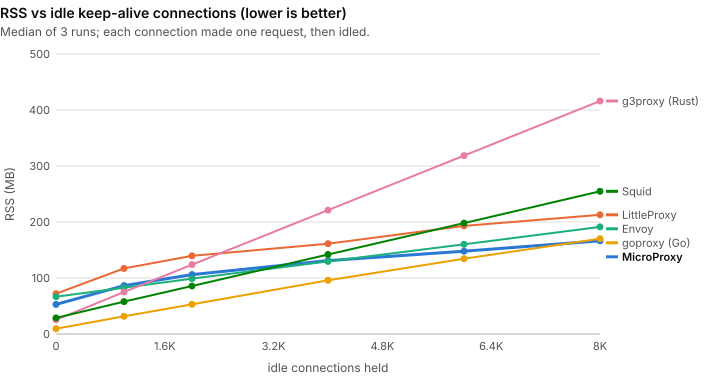
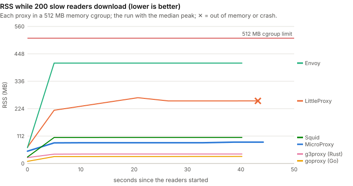

# Performance against other proxies

How MicroProxy compares with LittleProxy, Envoy, a Go forward proxy (goproxy), a Rust forward
proxy (g3proxy) and Squid on throughput, latency and memory, measured with the
[load-testing harness](load-testing.md) on one machine. Every number here comes from a dated run
whose raw JSON is committed beside this page; read the results as relative rather than absolute,
and reproduce them with the commands at the end.

<div class="mp-perf-chart" data-chart="maxrate" data-perf-src="../../assets/perf/results.json"></div>

## At a glance

Three runs on one shared 4-vCPU cloud VM, every proxy on one CPU; medians below, with every range
in the [scoreboard](#scoreboard). MicroProxy is not the fastest proxy here, and it is not the
smallest at rest. Where it stands out is memory under connections and slow clients:

- **Peak rate: LittleProxy and g3proxy lead.** Both sustained 14,901 requests a second, one step
  (×1.25) above MicroProxy, goproxy, Envoy and Squid, which all topped out at 9,537. The steps are
  coarse: a maximum of 9,537 means somewhere between 9,537 and 11,921.
- **Latency at 9,537 requests a second**, the highest rate every proxy sustained: g3proxy has the
  lowest tail (p99 5.2 ms, p99.9 14.3 ms), then LittleProxy (p99 6.2 ms), then MicroProxy (p99
  11.8 ms, p99.9 17.0 ms, second to g3proxy at p99.9) and goproxy (12.9 ms); Envoy (30.1 ms) and
  Squid (48.7 ms) were close to their limit on one CPU.
- **Idle memory: the native proxies are smaller.** goproxy idles at 9.4 MB, g3proxy at 25.3 MB and
  Squid at 28.8 MB; MicroProxy at 52.9 MB, Envoy at 66.6 MB and LittleProxy at 72.0 MB.
- **Idle connections: MicroProxy has the lowest median memory per connection** (10.9 KB of RSS
  each, against 15.2 KB for LittleProxy, 15.8 KB for Envoy, 20.3 KB for goproxy, 28.8 KB for Squid
  and 49.9 KB for g3proxy) and in total at 8,000 idle connections (166.5 MB, goproxy next at
  170.3 MB). One of its three runs was higher (15.6 KB, 193 MB), so its lead over LittleProxy per
  connection, and over goproxy in total, is within run-to-run noise.
- **Slow readers: MicroProxy holds about 190 KB per reader, LittleProxy about 1 MB and Envoy about
  1.8 MB.** With 200 clients reading 16 MB responses at 8 KB/s, LittleProxy ran out of its 128 MB of
  direct memory in every run, and Envoy, with its default 1 MiB buffers, peaked at 410 MB of its
  512 MB cap. g3proxy (75 KB) and goproxy (102 KB) held less than MicroProxy.
- **Slowloris is MicroProxy's weakest memory result**: the highest peak of the six (127.9 MB for
  2,000 trickling connections), against 33.9 MB for goproxy.
- **Every proxy stayed up and bounded** through the faults and the soak, with no leak flagged.

## Scoreboard

Each row is one measure, each cell the median of the runs with the lowest and highest run in
parentheses. The best median of each row is in bold, and the last column names it; "ranges overlap"
means the runner-up's range reaches it, so the lead is within run-to-run noise. "n/a" means the
measure does not apply or was not measured.

<!-- perf:scoreboard -->

| Metric (median, min–max of the runs) | MicroProxy | LittleProxy | Envoy | goproxy (Go) | g3proxy (Rust) | Squid | Best median |
|---|---|---|---|---|---|---|---|
| Max sustainable rate (req/s) | 9,537 (9,537–11,921) | 14,901 | 9,537 (2 runs) | 9,537 (9,537–11,921) | 14,901 (2 runs) | 9,537 (7,630–9,537) | tie |
| p50 latency at 9,537 req/s (ms) | 0.35 (0.30–0.36) | 0.46 (0.41–0.46) | 2.00 (1.75–2.25) (2 runs) | 0.34 (0.32–0.42) | **0.24 (0.24–0.24) (2 runs)** | 0.83 (0.55–1.93) | g3proxy (Rust) |
| p99 latency at 9,537 req/s (ms) | 11.81 (8.27–17.81) | 6.19 (5.92–10.10) | 30.06 (18.21–41.92) (2 runs) | 12.87 (9.81–19.60) | **5.21 (4.43–6.00) (2 runs)** | 48.73 (16.34–60.70) | g3proxy (Rust) (ranges overlap) |
| p99.9 latency at 9,537 req/s (ms) | 16.96 (11.94–22.61) | 17.33 (13.94–19.39) | 39.36 (22.91–55.81) (2 runs) | 18.88 (17.73–30.18) | **14.26 (11.21–17.31) (2 runs)** | 65.98 (18.45–68.16) | g3proxy (Rust) (ranges overlap) |
| Idle RSS (MB) | 52.9 (52.8–53.0) | 72.0 (71.8–77.1) | 66.6 (66.4–67.8) | **9.4 (9.4–9.4)** | 25.3 (25.0–25.5) | 28.8 (28.5–29.0) | goproxy (Go) |
| RSS per idle connection (KB) | **10.9 (10.7–15.6)** | 15.2 (13.2–16.1) | 15.8 (15.8–15.8) | 20.3 (20.3–20.6) | 49.9 (49.9–49.9) | 28.8 (28.7–29.0) | MicroProxy (ranges overlap) |
| RSS holding 8,000 idle connections (MB) | **166.5 (161.2–193.3)** | 212.8 (210.6–226.1) | 191.2 (190.8–191.2) | 170.3 (170.2–172.6) | 416.0 (416.0–416.2) | 254.8 (254.1–256.6) | MicroProxy (ranges overlap) |
| Peak RSS under slowloris (MB, 512 MB cap) | 127.9 (121.5–133.3) | 99.6 (92.4–112.3) | 105.6 (105.1–105.8) | **33.9 (33.9–34.1)** | 109.8 (109.4–109.9) | 40.4 (40.3–40.8) | goproxy (Go) |
| RSS per slow reader, 200 readers (KB) | 190 (170–191) | 1,037 (1,023–1,092) | 1,770 (1,755–1,838) | 102 (100–103) | **75 (75–75)** | 409 (409–418) | g3proxy (Rust) |
| Peak RSS under slow readers (MB, 512 MB cap) | 87.2 (83.4–87.6) | 268.9 (266.6–279.5) | 410.2 (404.4–422.9) | **28.7 (28.3–28.8)** | 38.7 (38.5–38.7) | 106.4 (106.3–108.1) | goproxy (Go) |
| Peak RSS under parallel large uploads and downloads (MB, 512 MB cap) | 82.2 (79.6–82.8) | 197.8 (197.3–203.8) | 125.3 (124.9–126.7) | **17.0 (16.9–17.0)** | 28.4 (26.9–28.7) | 36.8 (36.7–37.4) | goproxy (Go) |

<!-- /perf:scoreboard -->

## Throughput and latency

The rate sweep offers open-loop load over 128 keep-alive connections, 128-byte responses, starting
at 2,000 requests a second and multiplying the rate by 1.25 every 8 seconds. Latency is measured
from each request's intended send time, so a stall counts against every request scheduled during it
(no coordinated omission). A step is sustained when its p99 is within 50 ms, nothing failed, at
least 95% of the offered rate completed and almost nothing was left unsent. The knee is the first
of two unsustained steps in a row, and the maximum sustainable rate is the highest sustained step
before it. Every proxy has one CPU (see [Methodology](#methodology)).

### Max sustainable rate

The chart at the top of the page; the same data as a static chart:

<div class="mp-perf-static" markdown>



</div>

<!-- perf:sweep -->

| Proxy | Max sustainable rate (req/s) | p99 at 9,537 req/s (ms) | p99.9 at 9,537 req/s (ms) | Proxy CPU at that rate | Why the knee came | Steps discarded (load generator behind) |
|---|---|---|---|---|---|---|
| MicroProxy | 9,537 (9,537–11,921) | 11.81 (8.27–17.81) | 16.96 (11.94–22.61) | 77% (74–82) | p99 over the SLO, fell behind the offered rate, requests left unsent | 0 |
| LittleProxy | 14,901 | 6.19 (5.92–10.10) | 17.33 (13.94–19.39) | 86% (85–86) | p99 over the SLO, requests left unsent | 0 |
| Envoy | 9,537 (2 runs) (1 run ended by the load generator, left out) | 30.06 (18.21–41.92) (2 runs) | 39.36 (22.91–55.81) (2 runs) | 97% (97–97) (2 runs) | p99 over the SLO, requests left unsent | 1 |
| goproxy (Go) | 9,537 (9,537–11,921) | 12.87 (9.81–19.60) | 18.88 (17.73–30.18) | 82% (79–83) | p99 over the SLO, requests left unsent | 0 |
| g3proxy (Rust) | 14,901 (2 runs) (1 run ended by the load generator, left out) | 5.21 (4.43–6.00) (2 runs) | 14.26 (11.21–17.31) (2 runs) | 58% (57–58) (2 runs) | p99 over the SLO | 1 |
| Squid | 9,537 (7,630–9,537) | 48.73 (16.34–60.70) | 65.98 (18.45–68.16) | 93% (92–94) | p99 over the SLO, fell behind the offered rate, requests left unsent | 0 |

<!-- /perf:sweep -->

### Latency as the load climbs

Drag the offered-load dial, or replay the climb. The readout ranks the proxies at the dial's rate.

<div class="mp-perf-chart" data-chart="latency"></div>

<div class="mp-perf-static" markdown>



</div>

The p99 at every step, in milliseconds (median of the runs; ✗ marks a step not sustained in most
runs; a proxy's column ends where its sweep stopped):

<!-- perf:latency -->

| Offered req/s | MicroProxy p99 (ms) | LittleProxy p99 (ms) | Envoy p99 (ms) | goproxy (Go) p99 (ms) | g3proxy (Rust) p99 (ms) | Squid p99 (ms) |
|---|---|---|---|---|---|---|
| 2,000 | 5.25 | 4.58 | 4.39 | 4.68 | 3.30 | 5.75 |
| 2,500 | 6.75 | 6.43 | 4.90 | 5.46 | 3.50 | 4.83 |
| 3,125 | 3.36 | 3.11 | 8.62 (2 runs) | 3.67 | 2.50 (2 runs) | 3.62 |
| 3,906 | 3.84 | 2.92 | 4.56 (2 runs) | 3.81 | 4.26 (2 runs) | 3.81 |
| 4,883 | 2.82 | 5.15 | 10.09 (2 runs) | 4.63 | 3.43 (2 runs) | 29.77 |
| 6,104 | 5.58 | 5.06 | 6.97 (2 runs) | 7.88 | 2.87 (2 runs) | 7.25 |
| 7,629 | 8.30 | 6.18 | 23.84 (2 runs) | 12.60 | 3.04 (2 runs) | 8.89 |
| 9,537 | 11.81 | 6.19 | 30.06 (2 runs) | 12.87 | 5.21 (2 runs) | 48.73 |
| 11,921 | 58.49 ✗ | 24.99 | 570.37 ✗ (2 runs) | 148.22 ✗ | 54.54 ✗ (2 runs) | 306.18 ✗ |
| 14,901 | 460.54 ✗ | 32.03 | 1,333.25 ✗ (2 runs) | 416.25 ✗ | 11.85 (2 runs) | 1,302.53 ✗ (2 runs) |
| 18,626 | 2,085.89 ✗ (1 run) | 110.27 ✗ | – | 1,763.33 ✗ (1 run) | 77.79 ✗ (2 runs) | – |
| 23,283 | – | 1,327.10 ✗ | – | – | 1,433.60 ✗ (2 runs) | – |

<!-- /perf:latency -->

### The whole latency distribution

<div class="mp-perf-chart" data-chart="percentiles"></div>

## Memory

Memory is the resident set size (RSS) the kernel charges each proxy process, sampled from
`/proc`. It is the one measure that means the same thing for a JVM and a native process; the JVM
proxies' heap and Native Memory Tracking figures are in the raw results.

### Idle

<div class="mp-perf-chart" data-chart="idle"></div>

<div class="mp-perf-static" markdown>



</div>

### Idle keep-alive connections

<div class="mp-perf-chart" data-chart="ramp"></div>

<div class="mp-perf-static" markdown>



</div>

<!-- perf:ramp -->

| Proxy | Idle RSS (MB) | RSS per idle connection (KB) | Connections held | Ramp ended |
|---|---|---|---|---|
| MicroProxy | 52.9 (52.8–53.0) | 10.9 (10.7–15.6) | 8,000 | limit not reached ×3 |
| LittleProxy | 72.0 (71.8–77.1) | 15.2 (13.2–16.1) | 8,000 | limit not reached ×3 |
| Envoy | 66.6 (66.4–67.8) | 15.8 (15.8–15.8) | 8,000 | limit not reached ×3 |
| goproxy (Go) | 9.4 (9.4–9.4) | 20.3 (20.3–20.6) | 8,000 | limit not reached ×3 |
| g3proxy (Rust) | 25.3 (25.0–25.5) | 49.9 (49.9–49.9) | 8,000 | limit not reached ×3 |
| Squid | 28.8 (28.5–29.0) | 28.8 (28.7–29.0) | 8,000 | limit not reached ×3 |

<!-- /perf:ramp -->

### Adversarial clients, under a memory cap

<div class="mp-perf-chart" data-chart="race"></div>

<div class="mp-perf-static" markdown>



</div>

Every run of every workload, with the harness's verdict (see
[how memory growth is judged](load-testing.md#how-memory-growth-is-judged)). "RSS per connection"
is the peak RSS over the idle baseline, divided by the workload's connections:

<!-- perf:memory -->

| Workload | Proxy | Verdicts | Peak RSS (MB) | RSS per connection (KB) | Honest probes answered | Proxy at the end |
|---|---|---|---|---|---|---|
| slowloris | MicroProxy | bounded ×3 | 127.9 (121.5–133.3) | 37 (33–39) | 100% | running ×3 |
| slowloris | LittleProxy | bounded ×3 | 99.6 (92.4–112.3) | 10 (7–14) | 100% | running ×3 |
| slowloris | Envoy | bounded ×3 | 105.6 (105.1–105.8) | 20 (20–20) | 100% | running ×3 |
| slowloris | goproxy (Go) | bounded ×3 | 33.9 (33.9–34.1) | 13 (13–13) | 100% | running ×3 |
| slowloris | g3proxy (Rust) | bounded ×3 | 109.8 (109.4–109.9) | 43 (43–43) | 100% | running ×3 |
| slowloris | Squid | bounded ×3 | 40.4 (40.3–40.8) | 6 (6–6) | 100% | running ×3 |
| slowread | MicroProxy | bounded ×3 | 87.2 (83.4–87.6) | 190 (170–191) | 100% | running ×3 |
| slowread | LittleProxy | oom ×3 | 268.9 (266.6–279.5) | 1,037 (1,023–1,092) | 83% (80–83) | oom (still running) ×3 |
| slowread | Envoy | bounded ×3 | 410.2 (404.4–422.9) | 1,770 (1,755–1,838) | 100% | running ×3 |
| slowread | goproxy (Go) | bounded ×3 | 28.7 (28.3–28.8) | 102 (100–103) | 100% | running ×3 |
| slowread | g3proxy (Rust) | bounded ×3 | 38.7 (38.5–38.7) | 75 (75–75) | 100% | running ×3 |
| slowread | Squid | bounded ×3 | 106.4 (106.3–108.1) | 409 (409–418) | 100% | running ×3 |
| updown | MicroProxy | bounded ×1, inconclusive ×2 | 82.2 (79.6–82.8) | 1,022 (941–1,042) | 100% | running ×3 |
| updown | LittleProxy | bounded ×3 | 197.8 (197.3–203.8) | 4,265 (4,210–4,508) | 100% | running ×3 |
| updown | Envoy | bounded ×3 | 125.3 (124.9–126.7) | 1,941 (1,940–2,003) | 100% | running ×3 |
| updown | goproxy (Go) | bounded ×3 | 17.0 (16.9–17.0) | 265 (261–266) | 100% | running ×3 |
| updown | g3proxy (Rust) | bounded ×3 | 28.4 (26.9–28.7) | 146 (143–152) | 100% | running ×3 |
| updown | Squid | bounded ×3 | 36.8 (36.7–37.4) | 332 (325–347) | 100% | running ×3 |

<!-- /perf:memory -->

## Soak and faults

The soak holds 2,000 requests a second for 100 seconds and fits a line through RSS after a 30 s
warm-up; the verdict is a possible leak only when the line fits well and grows by more than 16 MB
and 10% (see [the scenarios](load-testing.md#the-scenarios)). A 100 s soak catches a fast leak,
not a slow one.

<!-- perf:soak -->

| Proxy | Leak verdicts | RSS slope (KB/hour) | Median per-window p99 (ms) | Errors |
|---|---|---|---|---|
| MicroProxy | no-leak ×3 | 2,757 (994–3,086) | 4.39 (3.70–4.75) | 0 |
| LittleProxy | no-leak ×3 | 11,780 (5,106–552,846) | 4.23 (3.76–4.29) | 0 |
| Envoy | no-leak ×3 | 3,261 (962–12,182) | 4.33 (3.98–4.86) | 0 |
| goproxy (Go) | no-leak ×3 | 4,169 (2,051–14,565) | 3.59 (3.23–3.72) | 0 |
| g3proxy (Rust) | no-leak ×3 | 676 (471–2,314) | 3.78 (3.25–4.07) | 0 |
| Squid | no-leak ×3 | 0 (0–368) | 4.67 (4.38–4.67) | 0 |

<!-- /perf:soak -->

The fault scenario puts a fault-injecting relay between the proxy and the origin, sends 20
requests through it, and checks that the proxy answers or closes within its timeouts and that it
closes the relay's connections and its own file descriptors within its idle timeout ("bounded").
Each cell gives the runs in which the fault was bounded, and the most common outcome seen by the
client:

<!-- perf:faults -->

| Fault | MicroProxy | LittleProxy | Envoy | goproxy (Go) | g3proxy (Rust) | Squid |
|---|---|---|---|---|---|---|
| latency | 3/3 bounded; OK:20 | 3/3 bounded; OK:20 | 3/3 bounded; OK:20 | 3/3 bounded; OK:20 | 3/3 bounded; OK:20 | 3/3 bounded; OK:20 |
| bandwidth | 3/3 bounded; OK:20 | 3/3 bounded; OK:20 | 3/3 bounded; OK:20 | 3/3 bounded; OK:20 | 3/3 bounded; OK:20 | 3/3 bounded; OK:20 |
| reset-before-headers | 3/3 bounded; BAD_STATUS:20 | 3/3 bounded; BAD_STATUS:20 | 3/3 bounded; BAD_STATUS:20 | 3/3 bounded; BAD_STATUS:20 | 3/3 bounded; BAD_STATUS:20 | 3/3 bounded; BAD_STATUS:20 |
| reset-mid-body | 3/3 bounded; TRUNCATED:20 | 3/3 bounded; TRUNCATED:20 | 3/3 bounded; TRUNCATED:20 | 3/3 bounded; TRUNCATED:20 | 3/3 bounded; TRUNCATED:20 | 3/3 bounded; TRUNCATED:20 |
| stall-mid-body | 3/3 bounded; TRUNCATED:20 | 3/3 bounded; TRUNCATED:20 | 3/3 bounded; TRUNCATED:20 | 3/3 bounded; TIMEOUT:20 | 3/3 bounded; TRUNCATED:20 | 3/3 bounded; TRUNCATED:20 |
| blackhole | 3/3 bounded; BAD_STATUS:20 | 3/3 bounded; BAD_STATUS:20 | 3/3 bounded; BAD_STATUS:20 | 3/3 bounded; BAD_STATUS:20 | 3/3 bounded; BAD_STATUS:20 | 3/3 bounded; BAD_STATUS:20 |

<!-- /perf:faults -->

## Methodology

### The machine, and sharing it

<!-- perf:machine -->

|  |  |
|---|---|
| CPU | Intel(R) Xeon(R) Processor @ 2.10GHz, 4 vCPUs |
| Memory | 16,093 MB |
| OS | Ubuntu 24.04.5 LTS, Linux 6.18.44-fc-v114 |
| JDK | OpenJDK 64-Bit Server VM 21.0.12.1+1-1-24.04.4-Ubuntu |
| CPU split (taskset) | proxy 0, origin 1, client 2-3 |
| Runs | 3 (20261013-051243, 20261013-060241, 20261013-065146 UTC) |
| Harness commit | acf503ec9850c408a65b2be8504262db1394ad3f |

<!-- /perf:machine -->

This is one cloud VM with 4 vCPUs, not a dedicated benchmark host, and other sessions' builds and
test suites share it. Three things keep them out of the numbers:

- **Priority.** The harness runs the proxy, the origin and the load generator at nice -20 and sets
  its scheduling autogroup to -20, so other sessions yield the CPUs to them (see
  [running on a shared machine](load-testing.md#running)).
- **A quiet window.** The other work on the machine was paused for the published runs.
- **A guard.** A monitor beside the harness
  ([`hostmon.py`](https://github.com/mahmoudimus/MicroProxy/blob/main/loadtest/competitors/hostmon.py))
  logged every 5 seconds the load average, the CPU the machine spent outside the benchmark's own
  processes (interrupt time, much of it the benchmark's own loopback traffic, kept apart) and the
  busiest outside processes. A run is accepted only if that foreign CPU averaged at most 50% of one
  CPU over the run, with a 95th percentile of at most 100%; otherwise it is rejected and run again.
  The aggregation script refuses to publish a run that fails the guard. A first run, made while
  other sessions were running CPU-bound loops, was rejected this way and repeated; its raw output
  is not used here.

The runs that are published, and what else ran during each:

<!-- perf:contamination -->

| Run (UTC start) | Foreign CPU, mean / p95 / max (% of one CPU) | Load average, mean / max | Busiest outside processes (mean CPU; kernel threads include some interrupt work) | Guard |
|---|---|---|---|---|
| 20261013-051243 | 5.1% / 23.9% / 94.3% | 1.97 / 9.64 | kernel thread 9.7%, agent session 4.8% | accepted |
| 20261013-060241 | 4.5% / 17.8% / 136.0% | 1.84 / 9.05 | kernel thread 10.4%, agent session 2.7% | accepted |
| 20261013-065146 | 5.1% / 20.8% / 150.5% | 1.78 / 9.65 | kernel thread 12.3%, agent session 3.1%, java 0.2% | accepted |

<!-- /perf:contamination -->

The remaining foreign CPU is mostly the agent process that drove the runs and kernel workers.
Interference that remains shows as noise between runs, which is why every figure is a median with
its range, and why a sweep's knee needs two unsustained steps in a row.

### One CPU per proxy

Every proxy runs on CPU 0 alone (`taskset -c 0`), the origin on CPU 1 and the load generator on
CPUs 2 and 3, for every proxy and every run. Each proxy is given one worker per CPU it is pinned
to: Envoy `--concurrency 1`, g3proxy one runtime thread, goproxy `GOMAXPROCS` 1 (Go's default from
the CPU affinity), Squid its single process, and the JVMs see one available processor (MicroProxy's
virtual threads run on one carrier thread; LittleProxy keeps its default thread pools of 2
acceptor, 8 client-side and 8 server-side event-loop threads, all on that one CPU). The JVMs'
garbage collector and JIT compiler share that CPU too, which is part of what a JVM costs.

One CPU, rather than two, is what lets the load generator and the origin outrun every proxy on a
4-vCPU machine: at two CPUs per proxy the sweep would measure the load generator. The harness
checks this: a step at which the load generator could not keep its own schedule is flagged and
counted above. So these are single-core results; how each proxy scales across cores is not
measured here.

### The proxies and their configuration

<!-- perf:versions -->

| Proxy | Language | Version | Command line (sweep run) |
|---|---|---|---|
| MicroProxy | Java (virtual threads) | MicroProxy 0.2.0 (this repository at acf503e) | `nice -n -20 taskset -c 0 /usr/lib/jvm/java-21-openjdk-amd64/bin/java -Xmx1g -XX:+UseG1GC -XX:NativeMemoryTracking=summary -Xlog:gc:file=<logs>/gc.log:uptime,level,tags -XX:OnOutOfMemoryError=touch <logs>/microproxy-sweep.oom -Djava.util.logging.config.file=<logs>/microproxy-logging.properties -cp <repo>/loadtest/target/microproxy-lib/* org.microproxy.Launcher --port <port> --idle-timeout 70 --connect-timeout 40000 --proxy-alias loadtest` |
| LittleProxy | Java (Netty) | io.github.littleproxy:littleproxy 2.9.1 | `nice -n -20 taskset -c 0 /usr/lib/jvm/java-21-openjdk-amd64/bin/java -Xmx1g -XX:+UseG1GC -XX:NativeMemoryTracking=summary -Xlog:gc:file=<logs>/gc.log:uptime,level,tags -XX:OnOutOfMemoryError=touch <logs>/littleproxy-sweep.oom -Dorg.slf4j.simpleLogger.defaultLogLevel=error -Dorg.slf4j.simpleLogger.logFile=System.out -cp <repo>/loadtest/target/microproxy-loadtest.jar org.microproxy.loadtest.proxy.LittleProxyLauncher --port <port> --idle-timeout 70 --connect-timeout 40000` |
| Envoy | C++ | Envoy 1.39.4 | `nice -n -20 taskset -c 0 <repo>/loadtest/competitors/.tools/bin/envoy -c <logs>/envoy-sweep-envoy.yaml --concurrency 1 --log-level error --disable-hot-restart` |
| goproxy (Go) | Go | github.com/elazarl/goproxy v1.9.2 (go1.27.2) | `nice -n -20 taskset -c 0 <repo>/loadtest/competitors/.tools/bin/goproxy-proxy -addr 127.0.0.1:<port> -idle-timeout 70s -connect-timeout 40000ms` |
| g3proxy (Rust) | Rust | g3proxy 1.12.4 | `nice -n -20 taskset -c 0 <repo>/loadtest/competitors/.tools/bin/g3proxy -c <logs>/g3proxy-sweep-g3proxy.yaml` |
| Squid | C++ | Squid Cache: Version 6.14 | `nice -n -20 taskset -c 0 /usr/sbin/squid -N -d 1 -f <logs>/squid-sweep-squid.conf` |

<!-- /perf:versions -->

Every proxy is a plain HTTP/1.1 forward proxy on a loopback port, taking absolute-form requests
over keep-alive connections, with no access log, no cache, no TLS and no filters, the same idle
timeout (70 s; 3,600 s in the connection ramp, 5 s in the fault scenario) and the same upstream
connect timeout (40 s). `CONNECT` is enabled where it needs configuring, though no scenario here
uses it. The configurations, with comments on every setting that differs from the proxy's default:

- **MicroProxy**, built from this repository, through its real launcher
  (`org.microproxy.Launcher`), `-Xmx1g`, G1, errors-only logging.
- **LittleProxy** `io.github.littleproxy:littleproxy`, through the harness's
  [launcher](https://github.com/mahmoudimus/MicroProxy/blob/main/loadtest/src/main/java/org/microproxy/loadtest/proxy/LittleProxyLauncher.java)
  with the same limits as MicroProxy, `-Xmx1g`, G1.
- **Envoy**, the official release binary, with the dynamic forward proxy filter and cluster:
  [`envoy.yaml`](https://github.com/mahmoudimus/MicroProxy/blob/main/loadtest/competitors/envoy/envoy.yaml).
  Its route timeout is off (its 15 s default would cut slow readers off) and its circuit breakers
  raised (their default of 1,024 is a service-mesh safety valve the other proxies do not have); its
  buffer limits keep their 1 MiB default.
- **goproxy**, the most widely used Go forward-proxy library, in a
  [minimal server](https://github.com/mahmoudimus/MicroProxy/blob/main/loadtest/competitors/goproxy/main.go)
  with Go's upstream pool widened from its default of two idle connections per host.
- **g3proxy**, ByteDance's production forward proxy on tokio, chosen over a minimal hyper example
  because it is a complete proxy that people deploy; built from its release tag:
  [`g3proxy.yaml`](https://github.com/mahmoudimus/MicroProxy/blob/main/loadtest/competitors/g3proxy/g3proxy.yaml).
- **Squid**, the distribution's package, one process in the foreground with caching off:
  [`squid.conf`](https://github.com/mahmoudimus/MicroProxy/blob/main/loadtest/competitors/squid/squid.conf).

Some differences cannot be made equal, and are part of what is measured:

- **Upstream connections.** Envoy, goproxy and Squid keep a shared pool of upstream connections;
  MicroProxy, LittleProxy and g3proxy hold one upstream connection per client connection. A pool
  needs fewer upstream sockets when many clients are idle.
- **The JVM.** MicroProxy and LittleProxy run with Native Memory Tracking on, which costs a little
  memory and CPU, and their RSS depends on heap sizing (here the harness's default, `-Xmx1g`); a
  smaller heap would lower it.
- **Not compared.** The h2c rapid-reset flood is left out: only MicroProxy is set up for HTTP/2
  over cleartext here. tinyproxy was tried and left out: it closes the client connection after
  every response, so the keep-alive scenarios do not apply to it.

### What each chart measures

- **Max sustainable rate**: the achieved rate of the highest sweep step that every check passed
  (p99 within 50 ms, no errors, at least 95% of the offered rate completed, almost no backlog). The
  offered rate climbs by a factor of 1.25 per step, so the result is known to within one step. A
  sweep that the load generator ended (a step where it could not keep its own schedule, flagged
  `clientSaturated`) is left out of the maximum, and such steps are left out of every latency
  figure; the sweep table counts them.
- **Latency as the load climbs**: p50, p99 or p99.9 at each offered rate, from each request's
  intended send time. A proxy's line continues one or two steps past its knee.
- **The whole latency distribution**: the latency at each percentile, from the same steps'
  HdrHistograms, at a rate every proxy sustained.
- **Idle memory**: RSS after start-up and a few validation requests (the ramp's baseline).
- **Idle keep-alive connections**: RSS at 1,000 to 8,000 idle keep-alive connections, each of which
  first made one request. RSS per connection is the slope of a line through those points. The
  largest step is set by the container's open-file limit (20,000 per process), not by any proxy.
  The machine's ephemeral port range was widened to 1024-65535 for the published runs, so that the
  sockets one proxy's ramp leaves in `TIME_WAIT` do not use up the ports of the next.
- **Adversarial clients**: RSS every 5 s while each workload runs for 40 s, with a fresh proxy in a
  512 MB memory cgroup for each workload: 200 slow readers (16 MB each, read at 8 KB/s), 2,000
  slowloris connections, and 16 parallel 64 MB uploads and downloads.

### Repetitions and spread

There were three runs, each a separate invocation of the harness that ran every scenario against
every proxy in turn, the proxies' order rotated between runs so that none always ran first. Every
scenario starts a fresh proxy process (each memory workload too), so no run inherits another's
state. The rate sweep warms each proxy up at 2,000 requests a second for 15 s before its first
recorded step, which gives the JVMs' JIT compilers time; its first steps are at low rates as well.
Each figure is the median of the three runs, with the lowest and highest run beside it; the
charts' whiskers, bands and tooltips show the same range.

### Caveats

- One machine, one moment: a shared 4-vCPU cloud VM. Another machine, kernel or CPU will give
  other numbers, and possibly another order. Compare the proxies with each other, not with numbers
  from elsewhere.
- Loopback only, 128-byte responses for the rate sweep, HTTP/1.1, no TLS: the proxy's per-request
  overhead dominates. Large bodies, real networks, TLS, HTTP/2 and MITM are not compared here.
- One CPU per proxy: multi-core scaling, where the native proxies' event loops and MicroProxy's
  virtual threads behave differently, is not measured.
- Short runs: 8 s sweep steps, 40 s adversarial workloads, a 100 s soak. They show the shape;
  they are not a long-term stability test.
- The Go proxy is a small program on a library; g3proxy, Envoy and Squid are complete proxies with
  features these scenarios do not exercise.

## Reproduce these results

Everything above comes from three commands on a Linux machine with at least 4 CPUs, `taskset`, and
root (for the memory cgroups and Squid's package):

```bash
mvn -Pbench -DskipTests package -pl loadtest -am   # the harness
loadtest/competitors/setup.sh                      # Envoy, goproxy, g3proxy and Squid, into loadtest/competitors/.tools/
loadtest/competitors/run-all.sh                    # three runs (about three hours), then this page's data
```

[`setup.sh`](https://github.com/mahmoudimus/MicroProxy/blob/main/loadtest/competitors/setup.sh)
downloads or builds each proxy at the version pinned in
[`versions.env`](https://github.com/mahmoudimus/MicroProxy/blob/main/loadtest/competitors/versions.env),
checking Envoy's and Go's SHA-256 and g3proxy's commit (g3proxy also needs `capnproto` and
`libssl-dev` to build, and Rust, which it installs with `rustup-init` when missing). None of it is
part of the Maven build or CI, and nothing it downloads is committed.
[`run-all.sh`](https://github.com/mahmoudimus/MicroProxy/blob/main/loadtest/competitors/run-all.sh)
holds every setting of the runs, with a comment on each, and runs the harness three times with the
external proxies of
[`proxies.json`](https://github.com/mahmoudimus/MicroProxy/blob/main/loadtest/competitors/proxies.json).
While it runs, `hostmon.py` logs the machine's load beside it. Then
[`aggregate.py`](https://github.com/mahmoudimus/MicroProxy/blob/main/loadtest/competitors/aggregate.py)
computes the medians and ranges and rewrites this page's data, static charts and tables (between
their `<!-- perf:... -->` markers); the prose around them is written by hand and must be checked
against the new numbers. `REPS`, `PROXIES`, `SCENARIOS` and the CPU split can be overridden from
the environment (see the script's header), and `PUBLISH=0` keeps the results out of `docs/`. A run
that fails the contamination guard stops the publication: run it again, and list the failed one
under `"rejected"` (with its `rep` and a `reason`) in the results directory's `run-info.json`.

### The raw data

- [`results.json`](../assets/perf/results.json): the aggregates this page draws from (medians,
  ranges, every sweep step, every ramp step, the memory series), with the machine, versions,
  settings and command lines.
- `raw/`: each run's complete harness output, unedited: every step's latency summary and
  HdrHistogram, the per-second `/proc` samples of every process and CPU, every verdict and
  self-check, the settings and the exact command lines. The files are listed in `results.json`
  under `runs`.
