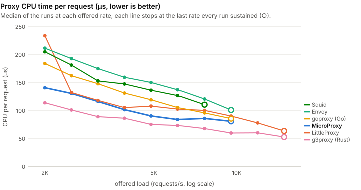

# Performance against other proxies

How MicroProxy compares with LittleProxy, Envoy, a Go forward proxy (goproxy), a Rust forward
proxy (g3proxy) and Squid on throughput, latency and memory, measured with the
[load-testing harness](load-testing.md) on one machine. Every number here comes from a dated run
whose raw JSON is committed beside this page; read the results as relative rather than absolute,
and reproduce them with the commands at the end.

<div class="mp-perf-chart" data-chart="cpu" data-perf-src="../../assets/perf/results.json"></div>

## At a glance

Five runs on a dedicated 11-core cloud VM, every proxy on one core, the JVMs on JDK 25; medians
below, and every run's value in the charts and the [spread table](#repetitions-and-spread).
MicroProxy is not the smallest proxy at rest, and it shares the top rate with g3proxy rather than
holding it alone:

- **Peak rate: g3proxy and MicroProxy lead, at about 49,000 to 50,000 requests a second** on one
  core (g3proxy 50,138, MicroProxy 48,748), every run of each within 2% of its median. g3proxy was
  ahead in every run, by about 3%; in a follow-up with a second core for the origin, MicroProxy
  was ahead by 1 to 2%, so the two are not ranked. Then LittleProxy (36,367), goproxy
  (29,927), Envoy (22,961) and Squid (20,537).
- **CPU per request explains the order.** At 18,626 requests a second, the highest rate every
  proxy sustained in every run, g3proxy spends 31 µs of CPU per request, MicroProxy 38 µs,
  goproxy 41 µs, LittleProxy 48 µs, Envoy 51 µs and Squid 53 µs, each within 3% from run to run.
  MicroProxy's and g3proxy's costs keep falling as the load rises, to 22 and 21 µs at 45,475
  requests a second, which is how a core carries them that far.
- **Latency at 18,626 requests a second**: every proxy's p50 is under 0.3 ms. The p99 is 0.34 ms
  for g3proxy, 0.35 ms for MicroProxy, 0.54 ms for LittleProxy, 0.56 ms for Envoy, 1.32 ms for
  goproxy and 2.19 ms for Squid; g3proxy's and MicroProxy's runs overlap (0.27 to 0.41 and 0.33 to
  0.47 ms).
- **Idle memory: the native proxies are smaller**, except Squid. goproxy idles at 9.5 MB and
  g3proxy at 25.1 MB; MicroProxy at 58.8 MB, Envoy at 67.5 MB, LittleProxy at 77.3 MB and Squid
  at 170.2 MB.
- **Idle connections: MicroProxy has the lowest memory per connection** (13.5 KB of RSS each,
  12.0 to 14.1 KB across runs, against 15.8 KB for Envoy, 17.9 KB for LittleProxy, 20.7 KB for
  goproxy, 29.1 KB for Squid and 49.9 KB for g3proxy). At 8,000 idle connections goproxy
  (174.6 MB) and MicroProxy (178.6 MB) hold the least, within run-to-run noise of each other.
- **Slow readers: MicroProxy holds about 150 KB per reader, LittleProxy about 1.1 MB and Envoy
  about 1.5 MB.** With 200 clients reading 16 MB responses at 8 KB/s, MicroProxy peaked at
  83.8 MB, LittleProxy at 279.9 MB (closing some of the readers itself in three of five runs) and
  Envoy at 360.1 MB of its 512 MB cap. goproxy (101 KB per reader) and g3proxy (75 KB) held less
  than MicroProxy, Squid more (466 KB).
- **The kernel holds the rest of what a slow reader has not taken**: 520 to 570 MB of socket
  buffers for 200 readers with MicroProxy, Envoy, goproxy and g3proxy, which stop reading the
  origin and leave the bytes in flight there; 354 MB with Squid, and 184 MB with LittleProxy,
  which keeps more of it in its own memory. A container whose memory limit counts socket buffers
  counts these too (see [Adversarial clients](#adversarial-clients-under-a-memory-cap)).
- **Parallel large uploads and downloads: LittleProxy ran out of memory in every run**, its own
  memory passing the 512 MB cap (it peaked at 457.5 MB of RSS in the runs that sampled it), where
  MicroProxy peaked at 84.1 MB, Envoy at 125.1 MB and Squid at 178.7 MB; goproxy (16.4 MB) and
  g3proxy (25.5 MB) held less than MicroProxy.
- **Slowloris is MicroProxy's weakest memory result**: 129.1 MB for 2,000 trickling connections,
  the highest after Squid's 181.8 MB, against 33.8 MB for goproxy.
- **Every proxy stayed up and bounded** through the faults and the soak, with no leak flagged.

## Scoreboard

Each row is one measure, each cell the median of the runs. A median is in bold when it is the best
of its row and clear of run-to-run noise: that proxy's worst run beats the runner-up's best. The
lowest and highest run of every cell are in the [spread table](#repetitions-and-spread). "n/a" means
the measure does not apply or was not measured.

<!-- perf:scoreboard -->

| Median of the runs | MicroProxy | LittleProxy | Envoy | goproxy (Go) | g3proxy (Rust) | Squid |
|---|---|---|---|---|---|---|
| Max sustainable rate (req/s) | 48,748 | 36,367 | 22,961 | 29,927 | **50,138** | 20,537 |
| Proxy CPU per request at 18,626 req/s (µs) | 38 | 48 | 51 | 41 | **31** | 53 |
| p50 latency at 18,626 req/s (ms) | 0.11 | 0.13 | 0.25 | 0.12 | 0.11 | 0.18 |
| p99 latency at 18,626 req/s (ms) | 0.35 | 0.54 | 0.56 | 1.32 | 0.34 | 2.19 |
| p99.9 latency at 18,626 req/s (ms) | 2.06 | 2.10 | 4.96 | 1.75 | 0.64 | 7.01 |
| Idle RSS (MB) | 58.8 | 77.3 | 67.5 | **9.5** | 25.1 | 170.2 |
| RSS per idle connection (KB) | **13.5** | 17.9 | 15.8 | 20.7 | 49.9 | 29.1 |
| RSS holding 8,000 idle connections (MB) | 178.6 | 229.9 | 191.3 | 174.6 | 416.2 | 398.4 |
| Peak RSS under slowloris (MB, 512 MB cap) | 129.1 | 112.4 | 100.0 | **33.8** | 106.5 | 181.8 |
| RSS per slow reader, 200 readers (KB) | 148 | 1,094 | 1,545 | 101 | **75** | 466 |
| Peak RSS under slow readers (MB, 512 MB cap) | 83.8 | 279.9 | 360.1 | **28.1** | 35.5 | 259.1 |
| Peak RSS under parallel large uploads and downloads (MB, 512 MB cap) | 84.1 | 457.5 ‡ | 125.1 | **16.4** | 25.5 | 178.7 |

‡ Measured in fewer runs than all, because in the others the proxy ran out of memory before the first memory sample: LittleProxy under parallel large uploads and downloads (3 of 5 runs).

<!-- /perf:scoreboard -->

## Throughput and latency

The rate sweep offers open-loop load over 128 keep-alive connections, 128-byte responses, starting
at 2,000 requests a second and multiplying the rate by 1.25 every 8 seconds. Latency is measured
from each request's intended send time, so a stall counts against every request scheduled during it
(no coordinated omission). A step is sustained when its p99 is within 50 ms, nothing failed, at
least 95% of the offered rate completed and almost nothing was left unsent. The knee is the first
of two unsustained steps in a row, and the maximum sustainable rate is the highest sustained step
before it. Every proxy has one CPU (see [Methodology](#methodology)).

Every curve below is the median of the same runs at every point, and stops at the highest offered
rate that every one of those runs sustained, marked with a ring: past it a proxy is overloaded, and
its latency is the length of its queue rather than anything about the proxy.

### CPU time per request

The chart at the top of the page: the proxy's CPU time per completed request, at each offered rate.
With one CPU, a proxy that needs N µs per request can serve at most 1,000,000 ÷ N requests a
second, so this is where the maximum rates below come from; a proxy whose cost falls as the load
rises (more ready sockets per wake-up, fewer thread switches) gets further than its cost at a low
rate suggests. It is also the steadier measure: at 18,626 requests a second each proxy's runs agree
within 3%, where their p99 latencies differ by up to six times. In microseconds per request,
median of the runs:

<div class="mp-perf-static" markdown>



</div>

<!-- perf:cpu -->

| Offered req/s | MicroProxy | LittleProxy | Envoy | goproxy (Go) | g3proxy (Rust) | Squid |
|---|---|---|---|---|---|---|
| 2,000 | 54 | 54 | 81 | 51 | 37 | 68 |
| 2,500 | 53 | 53 | 82 | 52 | 36 | 67 |
| 3,125 | 52 | 53 | 82 | 51 | 36 | 67 |
| 3,906 | 49 | 48 | 79 | 49 | 34 | 64 |
| 4,883 | 48 | 46 | 78 | 48 | 34 | 64 |
| 6,104 | 48 | 46 | 78 | 48 | 33 | 64 |
| 7,629 | 47 | 48 | 77 | 48 | 33 | 64 |
| 9,537 | 47 | 46 | 75 | 48 | 33 | 64 |
| 11,921 | 46 | 48 | 69 | 47 | 33 | 60 |
| 14,901 | 42 | 49 | 60 | 44 | 32 | 57 |
| 18,626 | 38 | 48 | 51 | 41 | 31 | 53 |
| 23,283 | 34 | 43 | – | 38 | 29 | – |
| 29,104 | 31 | 34 | – | 33 | 27 | – |
| 36,380 | 27 | – | – | – | 24 | – |
| 45,475 | 22 | – | – | – | 21 | – |

<!-- /perf:cpu -->

### Max sustainable rate

<div class="mp-perf-chart" data-chart="maxrate"></div>

<div class="mp-perf-static" markdown>


</div>

<!-- perf:sweep -->

| Proxy | Max sustainable rate (req/s) | CPU per request at 18,626 req/s (µs) | p99 at 18,626 req/s (ms) | Why the knee came |
|---|---|---|---|---|
| MicroProxy | 48,748 | 38 | 0.35 | p99 over the SLO, fell behind the offered rate, requests left unsent |
| LittleProxy | 36,367 | 48 | 0.54 | p99 over the SLO, fell behind the offered rate, requests left unsent |
| Envoy | 22,961 | 51 | 0.56 | p99 over the SLO, requests left unsent, fell behind the offered rate |
| goproxy (Go) | 29,927 | 41 | 1.32 | p99 over the SLO, fell behind the offered rate, requests left unsent |
| g3proxy (Rust) | 50,138 | 31 | 0.34 | p99 over the SLO, fell behind the offered rate, requests left unsent |
| Squid | 20,537 | 53 | 2.19 | p99 over the SLO, fell behind the offered rate, requests left unsent |

Every maximum is known to within 1.4% (refined).

<!-- /perf:sweep -->

### Latency as the load climbs

Each line ends where its proxy's sustained range does; the tooltip ranks only the proxies still
sustaining the rate under the cursor.

<div class="mp-perf-chart" data-chart="latency"></div>

<div class="mp-perf-static" markdown>


</div>

The p99 at every offered rate each proxy sustained in every run, in milliseconds (median of the
runs):

<!-- perf:latency -->

| Offered req/s | MicroProxy | LittleProxy | Envoy | goproxy (Go) | g3proxy (Rust) | Squid |
|---|---|---|---|---|---|---|
| 2,000 | 0.21 | 0.23 | 0.25 | 0.22 | 0.21 | 0.23 |
| 2,500 | 0.21 | 0.23 | 0.25 | 0.25 | 0.20 | 0.23 |
| 3,125 | 0.20 | 0.21 | 0.23 | 0.23 | 0.20 | 0.21 |
| 3,906 | 0.18 | 0.19 | 0.22 | 0.26 | 0.18 | 0.20 |
| 4,883 | 0.17 | 0.17 | 0.21 | 0.24 | 0.16 | 0.19 |
| 6,104 | 0.16 | 0.18 | 0.20 | 0.24 | 0.16 | 0.19 |
| 7,629 | 0.16 | 0.83 | 0.22 | 0.32 | 0.16 | 0.18 |
| 9,537 | 0.16 | 0.23 | 0.24 | 0.56 | 0.15 | 0.20 |
| 11,921 | 0.17 | 0.26 | 0.31 | 0.75 | 0.17 | 0.23 |
| 14,901 | 0.33 | 0.41 | 0.36 | 1.10 | 0.23 | 0.41 |
| 18,626 | 0.35 | 0.54 | 0.56 | 1.32 | 0.34 | 2.19 |
| 23,283 | 0.46 | 0.85 | – | 1.87 | 0.40 | – |
| 29,104 | 0.54 | 1.64 | – | 5.41 | 0.44 | – |
| 36,380 | 4.38 | – | – | – | 0.53 | – |
| 45,475 | 5.76 | – | – | – | 2.96 | – |

<!-- /perf:latency -->

### The whole latency distribution

<div class="mp-perf-chart" data-chart="percentiles"></div>

## Memory

Memory is the resident set size (RSS) the kernel charges each proxy process, sampled from
`/proc`. It is the one measure that means the same thing for a JVM and a native process; the JVM
proxies' heap and Native Memory Tracking figures are in the raw results.

### Idle

<div class="mp-perf-chart" data-chart="idle"></div>

<div class="mp-perf-static" markdown>


</div>

### Idle keep-alive connections

<div class="mp-perf-chart" data-chart="ramp"></div>

<div class="mp-perf-static" markdown>


</div>

<!-- perf:ramp -->

| Proxy | Idle RSS (MB) | RSS per idle connection (KB) | Connections held | Ramp ended |
|---|---|---|---|---|
| MicroProxy | 58.8 | 13.5 | 8,000 | limit not reached ×4, errors ×1 |
| LittleProxy | 77.3 | 17.9 | 8,000 | limit not reached ×4, errors ×1 |
| Envoy | 67.5 | 15.8 | 8,000 | limit not reached |
| goproxy (Go) | 9.5 | 20.7 | 8,000 | limit not reached |
| g3proxy (Rust) | 25.1 | 49.9 | 8,000 | limit not reached |
| Squid | 170.2 | 29.1 | 8,000 | limit not reached |

<!-- /perf:ramp -->

Every proxy held 8,000 idle connections in every run but two: in one run each, MicroProxy and
LittleProxy answered most of the ramp's probes with 502 (a failed connection to the origin, within
3 to 11 ms) from about 6,500 connections held. Both were the last proxy of their run, after the
other proxies' ramps; their other four runs held all 8,000.

### Adversarial clients, under a memory cap

<div class="mp-perf-chart" data-chart="race"></div>

<div class="mp-perf-static" markdown>


</div>

Each proxy's cap holds its own memory. The TCP socket buffers of its connections, which cgroup v2
also charges to the proxy's group, are kept out of the cap and shown beside it (the "Kernel socket
buffers" column): how much a slow reader leaves there is set mostly by the kernel, about 2.6 to
2.9 MB a reader on this machine once the proxy stops reading, so 200 readers fill a 512 MB cap on
their own. Counted inside the cap, as in the campaign's first runs, they had the cgroup's OOM
killer end five of the six proxies within a second, whatever the proxies held. A proxy in a
container whose memory limit counts socket buffers lives under that sum, and the harness measures
it that way with `--attack-cgroup-sockets include` (see
[the load-testing page](load-testing.md#how-memory-growth-is-judged)). The memory figures here come
from five runs of the memory scenario made on the same machine after that change (harness at
39aa8c5, the proxies and their settings unchanged); every other figure comes from the campaign's
five runs.

Every workload, median of the runs, with the harness's verdict (see
[how memory growth is judged](load-testing.md#how-memory-growth-is-judged)); a verdict stands alone
when every run agreed, and is counted otherwise. "RSS per connection" is the peak RSS over the idle
baseline, divided by the workload's connections:

<!-- perf:memory -->

| Workload | Proxy | Verdict | Peak RSS (MB) | RSS per connection (KB) | Kernel socket buffers, peak (MB) | Honest probes answered | Proxy at the end |
|---|---|---|---|---|---|---|---|
| slowloris | MicroProxy | bounded | 129.1 | 37 | 4.8 | 100% | running |
| slowloris | LittleProxy | bounded | 112.4 | 18 | 3.0 | 100% | running |
| slowloris | Envoy | bounded | 100.0 | 20 | 0.1 | 100% | running |
| slowloris | goproxy (Go) | bounded | 33.8 | 13 | 0.1 | 100% | running |
| slowloris | g3proxy (Rust) | bounded | 106.5 | 43 | 0.8 | 100% | running |
| slowloris | Squid | bounded | 181.8 | 6 | 0.0 | 100% | running |
| slowread | MicroProxy | bounded | 83.8 | 148 | 565.3 | 100% | running |
| slowread | LittleProxy | bounded ×2, shedding ×3 | 279.9 | 1,094 | 183.7 | 100% | running |
| slowread | Envoy | bounded | 360.1 | 1,545 | 572.4 | 100% | running |
| slowread | goproxy (Go) | bounded | 28.1 | 101 | 520.5 | 100% | running |
| slowread | g3proxy (Rust) | bounded | 35.5 | 75 | 520.5 | 100% | running |
| slowread | Squid | bounded | 259.1 | 466 | 354.3 | 100% | running |
| updown | MicroProxy | bounded | 84.1 | 941 | 13.3 | 100% | running |
| updown | LittleProxy | oom | 457.5 ‡ | 12,506 ‡ | 7.9 | 85% ‡ | oom |
| updown | Envoy | bounded | 125.1 | 2,144 | 21.2 | 100% | running |
| updown | goproxy (Go) | bounded | 16.4 | 257 | 18.5 | 100% | running |
| updown | g3proxy (Rust) | bounded | 25.5 | 145 | 4.2 | 100% | running |
| updown | Squid | bounded | 178.7 | 337 | 7.8 | 100% | running |

‡ Measured in fewer runs than all, because in the others the proxy ran out of memory before the first memory sample: LittleProxy under parallel large uploads and downloads (3 of 5 runs).

<!-- /perf:memory -->

## Soak and faults

The soak holds 2,000 requests a second for 100 seconds and fits a line through RSS after a 30 s
warm-up; the verdict is a possible leak only when the line fits well and grows by more than 16 MB
and 10% (see [the scenarios](load-testing.md#the-scenarios)). A 100 s soak catches a fast leak,
not a slow one.

<!-- perf:soak -->

| Proxy | Leak verdict | RSS slope (KB/hour) | Median per-window p99 (ms) | Errors |
|---|---|---|---|---|
| MicroProxy | no-leak | 7,597 | 0.22 | 0 |
| LittleProxy | no-leak | 12,314 | 0.23 | 0 |
| Envoy | no-leak | 4,633 | 0.25 | 0 |
| goproxy (Go) | no-leak | 755 | 0.21 | 0 |
| g3proxy (Rust) | no-leak | 0 | 0.20 | 0 |
| Squid | no-leak | 0 | 0.23 | 0 |

<!-- /perf:soak -->

The fault scenario puts a fault-injecting relay between the proxy and the origin, sends 20
requests through it, and checks that the proxy answers or closes within its timeouts and that it
closes the relay's connections and its own file descriptors within its idle timeout ("bounded").
Each cell gives the runs in which the fault was bounded, and the most common outcome seen by the
client:

<!-- perf:faults -->

| Fault | MicroProxy | LittleProxy | Envoy | goproxy (Go) | g3proxy (Rust) | Squid |
|---|---|---|---|---|---|---|
| latency | 5/5 bounded; OK:20 | 5/5 bounded; OK:20 | 5/5 bounded; OK:20 | 5/5 bounded; OK:20 | 5/5 bounded; OK:20 | 5/5 bounded; OK:20 |
| bandwidth | 5/5 bounded; OK:20 | 5/5 bounded; OK:20 | 5/5 bounded; OK:20 | 5/5 bounded; OK:20 | 5/5 bounded; OK:20 | 5/5 bounded; OK:20 |
| reset-before-headers | 5/5 bounded; BAD_STATUS:20 | 5/5 bounded; BAD_STATUS:20 | 5/5 bounded; BAD_STATUS:20 | 5/5 bounded; BAD_STATUS:20 | 5/5 bounded; BAD_STATUS:20 | 5/5 bounded; BAD_STATUS:20 |
| reset-mid-body | 5/5 bounded; TRUNCATED:20 | 5/5 bounded; TRUNCATED:20 | 5/5 bounded; TRUNCATED:20 | 5/5 bounded; TRUNCATED:20 | 5/5 bounded; TRUNCATED:20 | 5/5 bounded; TRUNCATED:20 |
| stall-mid-body | 5/5 bounded; TRUNCATED:20 | 5/5 bounded; TRUNCATED:20 | 5/5 bounded; TRUNCATED:20 | 5/5 bounded; TIMEOUT:20 | 5/5 bounded; TRUNCATED:20 | 5/5 bounded; TRUNCATED:20 |
| blackhole | 5/5 bounded; BAD_STATUS:20 | 5/5 bounded; BAD_STATUS:20 | 5/5 bounded; BAD_STATUS:20 | 5/5 bounded; BAD_STATUS:20 | 5/5 bounded; BAD_STATUS:20 | 5/5 bounded; BAD_STATUS:20 |

<!-- /perf:faults -->

## Methodology

### The machine, and sharing it

<!-- perf:machine -->

|  |  |
|---|---|
| CPU | Intel(R) Xeon(R) Platinum 8481C CPU @ 2.70GHz, 11 vCPUs |
| Memory | 88,486 MB |
| OS | Ubuntu 24.04.5 LTS, Linux 7.0.0-1014-gcp |
| JDK | OpenJDK 64-Bit Server VM 25.0.4.1+1-LTS |
| CPU split (taskset) | proxy 1, origin 2, client 3,4,5,6,7,8 |
| Runs | 5 (20261015-215158, 20261015-224705, 20261015-234222, 20261016-003717, 20261016-013155 UTC) |
| Harness commit | bfe751dcc0e4ec03b669031c7e9c782607906270 |
| Memory scenario runs | 5 (20261016-153422, 20261016-154722, 20261016-160022, 20261016-161320, 20261016-162620 UTC), run separately with the harness at 39aa8c54878b150b2dce8304e54ed23b73cf3c15 |

<!-- /perf:machine -->

A Google Cloud `c3-standard-22` VM (Intel Xeon Platinum 8481C) created with one thread per core,
so its 11 vCPUs are 11 physical cores and no two pinned processes share one; nothing else ran on
it during the campaign. It was prepared by
[`bootstrap.sh`](https://github.com/mahmoudimus/MicroProxy/blob/main/loadtest/competitors/dedicated/bootstrap.sh)
(packages, two pinned JDKs, the other proxies, the kernel settings below). A cloud VM still shares
its host with other tenants, and the guest cannot set the CPU frequency governor, so:

- **Priority.** The harness runs the proxy, the origin and the load generator at nice -20 (see
  [running on a shared machine](load-testing.md#running)).
- **A guard.** A monitor beside the harness
  ([`hostmon.py`](https://github.com/mahmoudimus/MicroProxy/blob/main/loadtest/competitors/hostmon.py))
  logged every 5 seconds the load average, the CPU the machine spent outside the benchmark's own
  processes (interrupt time, much of it the benchmark's own loopback traffic, kept apart) and the
  busiest outside processes. A run is accepted only if that foreign CPU averaged at most 50% of one
  CPU over the run, with a 95th percentile of at most 100%, and the monitor never went more than
  10 s without a sample; otherwise it is rejected and run again. The aggregation script refuses to
  publish a run that fails the guard. None of these five failed it.

The runs that are published, and what else ran during each:

<!-- perf:contamination -->

| Run (UTC start) | Foreign CPU, mean / p95 / max (% of one CPU) | Load average, mean / max | Busiest outside processes (mean CPU; kernel threads include some interrupt work) | Longest gap in the monitor's samples | Guard |
|---|---|---|---|---|---|
| 20261015-215158 | 7.5% / 52.0% / 435.6% | 1.76 / 14.84 | kernel thread 5.3% | 5.8 s | accepted |
| 20261015-224705 | 5.7% / 31.6% / 416.3% | 1.64 / 12.85 | kernel thread 3.9% | 5.1 s | accepted |
| 20261015-234222 | 6.0% / 43.8% / 197.7% | 1.63 / 11.87 | kernel thread 6.4%, sshd 0.1% | 5.1 s | accepted |
| 20261016-003717 | 5.3% / 42.3% / 188.6% | 1.74 / 15.19 | kernel thread 4.6%, sshd 0.1% | 5.1 s | accepted |
| 20261016-013155 | 7.6% / 53.6% / 495.4% | 1.69 / 14.27 | kernel thread 5.0%, sshd 0.1% | 5.1 s | accepted |
| 20261016-153422 (memory) | 8.4% / 68.5% / 147.5% | 0.95 / 2.19 | kernel thread 0.4%, python3 0.3%, agent session 0.2% | 5.5 s | accepted |
| 20261016-154722 (memory) | 5.7% / 22.6% / 152.3% | 1.06 / 2.66 | kernel thread 0.2% | 5.1 s | accepted |
| 20261016-160022 (memory) | 6.0% / 26.6% / 151.9% | 1.17 / 2.63 | none | 5.1 s | accepted |
| 20261016-161320 (memory) | 4.8% / 23.0% / 100.5% | 0.91 / 2.11 | kernel thread 1.0% | 5.1 s | accepted |
| 20261016-162620 (memory) | 4.7% / 18.1% / 113.7% | 0.78 / 1.90 | kernel thread 1.8%, agent session 0.2% | 5.1 s | accepted |

<!-- /perf:contamination -->

The foreign CPU is mostly kernel workers; its short peaks come with the connection ramps and the
adversarial workloads, which make the kernel open and tear down thousands of sockets. Interference
that remains shows as noise between runs, which is why every figure is a median of the runs with
each run shown, and why a sweep's knee needs two unsustained steps in a row.

### One CPU per proxy

Every proxy runs on CPU 1 alone (`taskset -c 1`), the origin on CPU 2 and the load generator on
CPUs 3 to 8, for every proxy and every run; CPU 0 is left to interrupts and housekeeping. Each
proxy is given one worker per CPU it is pinned to: Envoy `--concurrency 1`, g3proxy one runtime
thread, goproxy `GOMAXPROCS` 1 (Go's default from the CPU affinity), Squid its single process, and
the JVMs see one available processor (MicroProxy's virtual threads run on one carrier thread;
LittleProxy keeps its default thread pools of 2 acceptor, 8 client-side and 8 server-side
event-loop threads, all on that one CPU). The JVMs' garbage collector and JIT compiler share that
CPU too, which is part of what a JVM costs.

One CPU per proxy keeps the load generator and the origin ahead of every proxy, and the harness
checks that it did: a step at which the load generator could not keep its own schedule is flagged,
and none was in these runs. The origin had one core as well, and at the top two proxies' maximum
it was at 93 to 98% of it; a follow-up gave it a second core and no proxy's maximum rose (each
proxy's own core was at 98 to 100% at its knee), so the knee is the proxy's. These are single-core
results; how each proxy scales across cores is not measured here.

### The JDK

MicroProxy and LittleProxy ran on Temurin 25.0.4.1, the JDK the
[performance options](../guides/performance.md#the-jdk-25-for-throughput) recommend for
throughput. A second campaign on the same machine ran the two Java proxies on Temurin 21.0.12.1
(three runs, raw results on the
[`perf/gcp-20261016`](https://github.com/mahmoudimus/MicroProxy/tree/perf/gcp-20261016/loadtest/results)
branch). On JDK 21 they tie on rate: MicroProxy sustained 36,891 requests a second (35,876 to
37,209 across runs) and LittleProxy 36,859 (36,374 to 36,877), with MicroProxy using less CPU per
request at 29,104 requests a second (28 µs against 34 µs) and answering faster (p50 0.14 ms against
0.87 ms). On JDK 25 MicroProxy's maximum rises by a third and LittleProxy's does not: JDK 25's
virtual-thread pollers spare MicroProxy a thread switch for every ready socket (see
[what a request costs on one core](../architecture.md#what-a-request-costs-on-one-core)).

### The proxies and their configuration

<!-- perf:versions -->

| Proxy | Language | Version | Command line (sweep run) |
|---|---|---|---|
| MicroProxy | Java (virtual threads) | MicroProxy 0.3.0 (this repository at bfe751d) | `nice -n -20 taskset -c 1 <repo>/loadtest/competitors/.tools/temurin-25/bin/java -Xmx1g -XX:+UseG1GC -XX:NativeMemoryTracking=summary -Xlog:gc:file=<logs>/gc.log:uptime,level,tags -XX:OnOutOfMemoryError=touch <logs>/microproxy-sweep.oom -Djava.util.logging.config.file=<logs>/microproxy-logging.properties -cp <repo>/loadtest/target/microproxy-lib/* org.microproxy.Launcher --port <port> --idle-timeout 70 --connect-timeout 40000 --proxy-alias loadtest` |
| LittleProxy | Java (Netty) | io.github.littleproxy:littleproxy 2.9.1 | `nice -n -20 taskset -c 1 <repo>/loadtest/competitors/.tools/temurin-25/bin/java -Xmx1g -XX:+UseG1GC -XX:NativeMemoryTracking=summary -Xlog:gc:file=<logs>/gc.log:uptime,level,tags -XX:OnOutOfMemoryError=touch <logs>/littleproxy-sweep.oom -Dorg.slf4j.simpleLogger.defaultLogLevel=error -Dorg.slf4j.simpleLogger.logFile=System.out -cp <repo>/loadtest/target/microproxy-loadtest.jar org.microproxy.loadtest.proxy.LittleProxyLauncher --port <port> --idle-timeout 70 --connect-timeout 40000` |
| Envoy | C++ | Envoy 1.39.4 | `nice -n -20 taskset -c 1 <repo>/loadtest/competitors/.tools/bin/envoy -c <logs>/envoy-sweep-envoy.yaml --concurrency 1 --log-level error --disable-hot-restart` |
| goproxy (Go) | Go | github.com/elazarl/goproxy v1.9.2 (go1.27.2) | `nice -n -20 taskset -c 1 <repo>/loadtest/competitors/.tools/bin/goproxy-proxy -addr 127.0.0.1:<port> -idle-timeout 70s -connect-timeout 40000ms` |
| g3proxy (Rust) | Rust | g3proxy 1.12.4 | `nice -n -20 taskset -c 1 <repo>/loadtest/competitors/.tools/bin/g3proxy -c <logs>/g3proxy-sweep-g3proxy.yaml` |
| Squid | C++ | Squid Cache: Version 6.14 | `nice -n -20 taskset -c 1 /usr/sbin/squid -N -d 1 -f <logs>/squid-sweep-squid.conf` |

<!-- /perf:versions -->

Every proxy is a plain HTTP/1.1 forward proxy on a loopback port, taking absolute-form requests
over keep-alive connections, with no access log, no cache, no TLS and no filters, the same idle
timeout (70 s; 3,600 s in the connection ramp, 5 s in the fault scenario) and the same upstream
connect timeout (40 s). `CONNECT` is enabled where it needs configuring, though no scenario here
uses it. The configurations, with comments on every setting that differs from the proxy's default:

- **MicroProxy**, built from this repository, through its real launcher
  (`org.microproxy.Launcher`), `-Xmx1g`, G1, errors-only logging.
- **LittleProxy** `io.github.littleproxy:littleproxy`, through the harness's
  [launcher](https://github.com/mahmoudimus/MicroProxy/blob/main/loadtest/src/main/java/org/microproxy/loadtest/proxy/LittleProxyLauncher.java)
  with the same limits as MicroProxy, `-Xmx1g`, G1.
- **Envoy**, the official release binary, with the dynamic forward proxy filter and cluster:
  [`envoy.yaml`](https://github.com/mahmoudimus/MicroProxy/blob/main/loadtest/competitors/envoy/envoy.yaml).
  Its route timeout is off (its 15 s default would cut slow readers off) and its circuit breakers
  raised (their default of 1,024 is a service-mesh safety valve the other proxies do not have); its
  buffer limits keep their 1 MiB default.
- **goproxy**, the most widely used Go forward-proxy library, in a
  [minimal server](https://github.com/mahmoudimus/MicroProxy/blob/main/loadtest/competitors/goproxy/main.go)
  with Go's upstream pool widened from its default of two idle connections per host.
- **g3proxy**, ByteDance's production forward proxy on tokio, chosen over a minimal hyper example
  because it is a complete proxy that people deploy; built from its release tag:
  [`g3proxy.yaml`](https://github.com/mahmoudimus/MicroProxy/blob/main/loadtest/competitors/g3proxy/g3proxy.yaml).
- **Squid**, the distribution's package, one process in the foreground with caching off:
  [`squid.conf`](https://github.com/mahmoudimus/MicroProxy/blob/main/loadtest/competitors/squid/squid.conf).

Some differences cannot be made equal, and are part of what is measured:

- **Upstream connections.** Envoy, goproxy and Squid keep a shared pool of upstream connections;
  MicroProxy, LittleProxy and g3proxy hold one upstream connection per client connection. A pool
  needs fewer upstream sockets when many clients are idle.
- **The JVM.** MicroProxy and LittleProxy run with Native Memory Tracking on, which costs a little
  memory and CPU, and their RSS depends on heap sizing (here the harness's default, `-Xmx1g`); a
  smaller heap would lower it.
- **Not compared.** The h2c rapid-reset flood is left out: only MicroProxy is set up for HTTP/2
  over cleartext here. tinyproxy was tried and left out: it closes the client connection after
  every response, so the keep-alive scenarios do not apply to it.

### What each chart measures

- **CPU time per request**: the proxy process's user and system CPU time over a sweep step (every
  thread, so the JVMs' garbage collector and JIT compiler count), divided by the requests it
  completed, read from `/proc` before and after each step.
- **Max sustainable rate**: the achieved rate of the highest sweep step that every check passed
  (p99 within 50 ms, no errors, at least 95% of the offered rate completed, almost no backlog). The
  offered rate climbs by a factor of 1.25 per step, which by itself brackets the maximum only to
  within one step, so the harness then refines the knee: it bisects between the last sustained step
  and the knee with up to four more steps, judged by the same rules and each after 2 s at the
  bracket's lower rate, until the bracket is within 2%. An unsustained probe is repeated once, as a
  lone unsustained sweep step is. A sweep that the load generator ended (a step where it could not keep its own
  schedule, flagged `clientSaturated`) is left out of every sweep figure.
- **Latency as the load climbs**: p50, p99 or p99.9 at each offered rate, from each request's
  intended send time, up to the last offered rate every run sustained.
- **The whole latency distribution**: the latency at each percentile, from the same steps'
  HdrHistograms, at a rate every proxy sustained.
- **Idle memory**: RSS after start-up and a few validation requests (the ramp's baseline).
- **Idle keep-alive connections**: RSS at 1,000 to 8,000 idle keep-alive connections, each of which
  first made one request. RSS per connection is the slope of a line through those points. The
  largest step is a setting of the comparison, not a limit any proxy reached. `bootstrap.sh` widens
  the machine's ephemeral port range to 15000-64999 and turns on `TIME_WAIT` reuse, so that the
  sockets one proxy's ramp leaves behind do not use up the ports of the next.
- **Adversarial clients**: RSS every 5 s while each workload runs for 40 s, with a fresh proxy for
  each workload whose own memory is capped at 512 MB (its kernel socket buffers beside the cap,
  their peak read from the cgroup every 100 ms): 200 slow readers (16 MB each, read at 8 KB/s),
  2,000 slowloris connections, and 16 parallel 64 MB uploads and downloads. These come from five
  separate runs of the memory scenario on the same machine (see
  [Adversarial clients](#adversarial-clients-under-a-memory-cap)).

### Repetitions and spread

There were five runs, each a separate invocation of the harness that ran every scenario against
every proxy in turn, the proxies' order rotated between runs so that none always ran first. Every
scenario starts a fresh proxy process (each memory workload too), so no run inherits another's
state. The rate sweep warms each proxy up at 2,000 requests a second for 15 s before its first
recorded step, which gives the JVMs' JIT compilers time; its first steps are at low rates as well.
Each figure above is the median of the runs. With five runs the charts show every run as a dot
(or, on the curves, with "Show each run") rather than whiskers, and the tooltips list each run's
value. The lowest and highest run behind every median of the scoreboard:

<!-- perf:spread -->

| Lowest–highest run | MicroProxy | LittleProxy | Envoy | goproxy (Go) | g3proxy (Rust) | Squid |
|---|---|---|---|---|---|---|
| Max sustainable rate (req/s) | 48,592–49,434 | 35,872–37,398 | 22,961–23,260 | 29,927–30,348 | 49,971–50,606 | 20,140–20,537 |
| Proxy CPU per request at 18,626 req/s (µs) | 38–38 | 47–48 | 51–51 | 41–41 | 30–31 | 52–53 |
| p50 latency at 18,626 req/s (ms) | 0.11–0.11 | 0.13–0.13 | 0.25–0.25 | 0.12–0.12 | 0.11–0.11 | 0.15–0.19 |
| p99 latency at 18,626 req/s (ms) | 0.33–0.47 | 0.48–0.65 | 0.43–0.92 | 1.16–1.64 | 0.27–0.41 | 0.77–4.54 |
| p99.9 latency at 18,626 req/s (ms) | 0.68–3.11 | 1.66–2.98 | 2.21–6.37 | 1.59–2.10 | 0.55–2.41 | 5.96–8.04 |
| Idle RSS (MB) | 58.8–58.9 | 76.6–77.8 | 66.9–68.1 | 9.4–9.5 | 23.8–25.3 | 170.1–170.3 |
| RSS per idle connection (KB) | 12.0–14.1 | 16.9–20.3 | 15.8–15.8 | 20.6–21.0 | 49.9–50.0 | 29.1–29.2 |
| RSS holding 8,000 idle connections (MB) | 169.8–190.4 | 221.5–236.9 | 190.7–191.8 | 171.3–174.7 | 414.6–416.5 | 397.9–398.9 |
| Peak RSS under slowloris (MB, 512 MB cap) | 128.6–159.0 | 110.3–114.5 | 98.6–100.4 | 33.6–34.1 | 106.4–106.8 | 181.7–181.9 |
| RSS per slow reader, 200 readers (KB) | 146–167 | 962–1,207 | 1,435–1,603 | 99–102 | 74–76 | 466–467 |
| Peak RSS under slow readers (MB, 512 MB cap) | 83.4–87.9 | 254.3–302.3 | 339.2–372.1 | 27.8–28.2 | 35.4–35.6 | 258.9–259.2 |
| Peak RSS under parallel large uploads and downloads (MB, 512 MB cap) | 82.3–87.1 | 407.7–492.3 (3 of 5 runs) | 121.0–127.8 | 16.2–16.7 | 25.3–25.6 | 178.4–178.9 |

<!-- /perf:spread -->

### Caveats

- One machine, one moment: a dedicated 11-core cloud VM (Xeon Platinum 8481C, Linux 7.0).
  Another machine, kernel or CPU will give other numbers, and possibly another order. Compare the
  proxies with each other, not with numbers from elsewhere.
- Loopback only, 128-byte responses for the rate sweep, HTTP/1.1, no TLS: the proxy's per-request
  overhead dominates. Large bodies, real networks, TLS, HTTP/2 and MITM are not compared here.
- One CPU per proxy: multi-core scaling, where the native proxies' event loops and MicroProxy's
  virtual threads behave differently, is not measured.
- Short runs: 8 s sweep steps, 40 s adversarial workloads, a 100 s soak. They show the shape;
  they are not a long-term stability test.
- The Go proxy is a small program on a library; g3proxy, Envoy and Squid are complete proxies with
  features these scenarios do not exercise.

## Reproduce these results

Everything above comes from one script on a Linux machine with at least 5 physical cores (8 or
more give the load generator room), root, and nothing else running:

```bash
sudo loadtest/competitors/dedicated/bootstrap.sh                       # prepare, and print a machine report
sudo env JDK=25 RUN=1 loadtest/competitors/dedicated/bootstrap.sh      # then the five runs (about six hours)
```

[`bootstrap.sh`](https://github.com/mahmoudimus/MicroProxy/blob/main/loadtest/competitors/dedicated/bootstrap.sh)
installs the build tools and two pinned JDKs (Temurin 21 and 25, checked against their SHA-256),
builds the harness, applies the kernel settings the runs assume, splits the cores (the first left
to housekeeping, then the proxy, the origin and the load generator, one thread per physical core)
and runs `run-all.sh`. Its [README](https://github.com/mahmoudimus/MicroProxy/blob/main/loadtest/competitors/dedicated/README.md)
covers cloud instances and WSL2.

[`setup.sh`](https://github.com/mahmoudimus/MicroProxy/blob/main/loadtest/competitors/setup.sh)
downloads or builds each proxy at the version pinned in
[`versions.env`](https://github.com/mahmoudimus/MicroProxy/blob/main/loadtest/competitors/versions.env),
checking Envoy's and Go's SHA-256 and g3proxy's commit (g3proxy also needs `capnproto` and
`libssl-dev` to build, and Rust, which it installs with `rustup-init` when missing). None of it is
part of the Maven build or CI, and nothing it downloads is committed.
[`run-all.sh`](https://github.com/mahmoudimus/MicroProxy/blob/main/loadtest/competitors/run-all.sh)
holds every setting of the runs, with a comment on each, and runs the harness five times (`REPS`)
with the external proxies of
[`proxies.json`](https://github.com/mahmoudimus/MicroProxy/blob/main/loadtest/competitors/proxies.json).
While it runs, `hostmon.py` logs the machine's load beside it. Then
[`aggregate.py`](https://github.com/mahmoudimus/MicroProxy/blob/main/loadtest/competitors/aggregate.py)
computes the medians and spreads and rewrites this page's data, static charts and tables (between
their `<!-- perf:... -->` markers); the prose around them is written by hand and must be checked
against the new numbers. `aggregate.py --raw docs/assets/perf/raw --publish docs` regenerates all
of it from the raw data committed beside this page. `REPS`, `PROXIES`, `SCENARIOS` and the CPU split can be overridden from
the environment (see the script's header), and `PUBLISH=0` keeps the results out of `docs/`. A run
that fails the contamination guard stops the publication: run it again, and list the failed one
under `"rejected"` (with its `rep` and a `reason`) in the results directory's `run-info.json`. A
memory workload that the machine itself makes meaningless goes under `"notMeasured"` (with its
`scenario`, `attack` and `reason`), and the tables give the reason in its place. A memory scenario
run again on its own (after a harness change, say) is named by `"memoryFrom"` in `run-info.json`
(a results directory relative to it); its runs then give every memory figure, pass the same guard,
and are published under `raw/memory/`.

### The raw data

- [`results.json`](../assets/perf/results.json): the aggregates this page draws from (medians,
  every run's value, every sweep step, every ramp step, the memory series), with the machine,
  versions, settings and command lines.
- `raw/`: each run's complete harness output, unedited: every step's latency summary and
  HdrHistogram, the per-second `/proc` samples of every process and CPU, every verdict and
  self-check, the settings and the exact command lines. The files are listed in `results.json`
  under `runs`.
